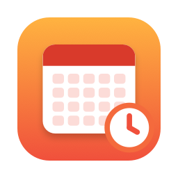
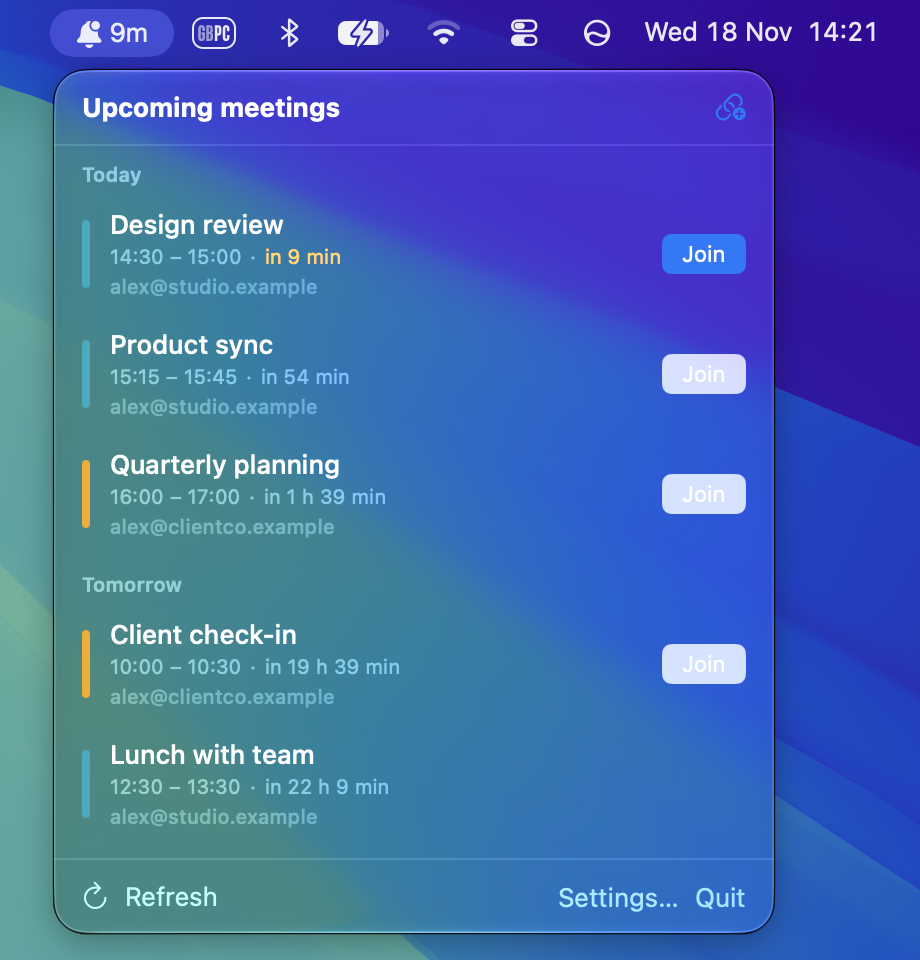
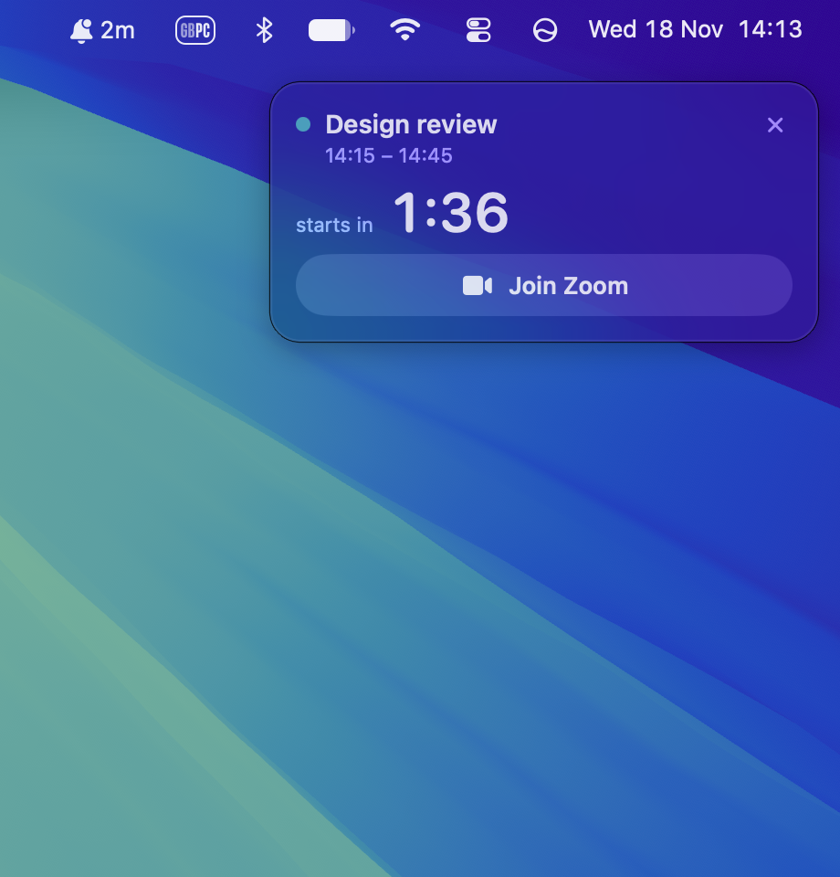

<div align="center">



# MeetingAlarm

**An alarm clock for meetings.**<br>
A macOS menu bar app that counts down to your next video call, then takes over the screen when it's time to join.

</div>

## Hard to miss, one click to join

<p align="center"></p>

The full-screen alert stays up until you click **Join** or **Dismiss**. Dismissed meetings stay dismissed, unless the meeting moves to a new time.

## In your menu bar, then in the corner

<table>
  <tr>
    <td width="50%"></td>
    <td width="50%"></td>
  </tr>
  <tr>
    <td align="center">Today and tomorrow at a glance. The menu bar counts down once a call is close.</td>
    <td align="center">From 10 minutes out, a live countdown in the corner. The Join button appears at 2 minutes.</td>
  </tr>
</table>

## Only the meetings you'll actually join

- **Finds the call link** for Google Meet, Zoom, Teams, Webex, Whereby, Around, Chime and Slack huddles, in the event's conference details, location or notes. Only meetings with a link alert you.
- **Skips the rest:** all-day, cancelled and declined events never alert.
- **Every account in one list**, each with its own colour. Work, personal and client calendars all count down together.
- **Your timings:** choose when the overlay, Join button and takeover appear, and where the overlay sits, how big and how see-through.
- **Stays current:** refreshes every 5 minutes, on wake and when the network comes back. Can launch at login.

## Install

MeetingAlarm is built from source. You need macOS 15+, Xcode 16+ and [XcodeGen](https://github.com/yonaskolb/XcodeGen).

```sh
brew install xcodegen
git clone https://github.com/KatieLG/meetingalarm.git
cd meetingalarm
make build
open build/Build/Products/Debug/MeetingAlarm.app
```

Move the app to `/Applications` to keep it. Then click the calendar icon in the menu bar, open **Settings… → Accounts**, turn on **Use calendars from the Mac Calendar app** and allow calendar access. Any account you've added in System Settings → Internet Accounts (Google, iCloud, Exchange and others) shows up, and you can choose which calendars to watch.

## Direct Google sign-in (optional)

If you'd rather not add your Google accounts to macOS, MeetingAlarm can read them directly. This needs your own OAuth client, and also skips Google's out-of-office and focus-time events.

1. In [Google Cloud Console](https://console.cloud.google.com/), create a project and enable the **Google Calendar API**.
2. Under **OAuth consent screen**, choose *External* and add each Google account you want to connect as a test user. In *Testing* mode, sign-ins expire after 7 days and need **Reconnect**. Publishing the app avoids that; Google shows a warning screen you can click through.
3. Under **Credentials**, create an **OAuth client ID** of type **Desktop app**.
4. Copy `Config/Secrets.xcconfig.example` to `Config/Secrets.xcconfig`, paste in the client ID and secret, and run `make build` again.

Then use **Settings… → Accounts → Add Google Account…** and sign in in your browser.

<sub>Everything runs on your Mac: calendars are read straight from Google or the Mac Calendar database, and Google sign-ins are kept in the login Keychain. Builds are ad-hoc signed, so after a rebuild macOS may ask once to allow Keychain access; choose Always Allow. Debug builds have buttons in the popover that add fake meetings at +11m, +2:10 and +0:40, or launch with `--args -debugMeetings 40,130,660`. Run the tests with `make test`.</sub>
